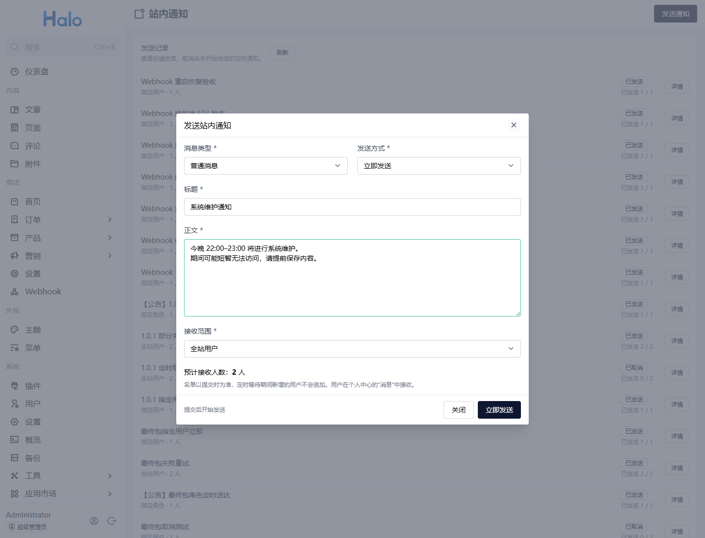
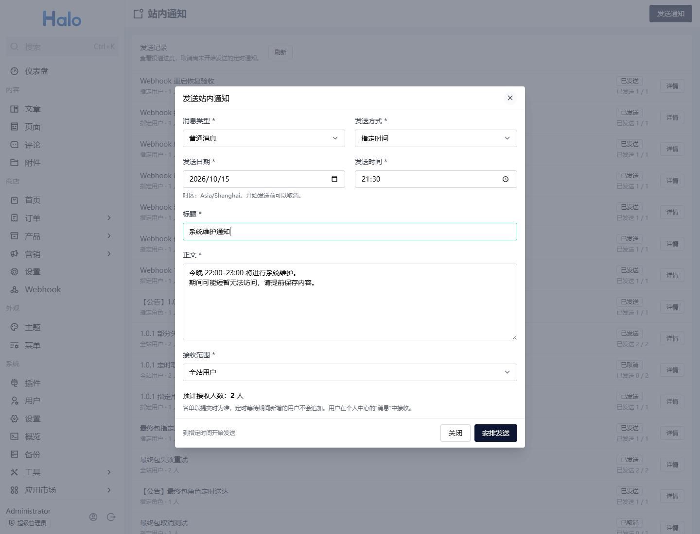
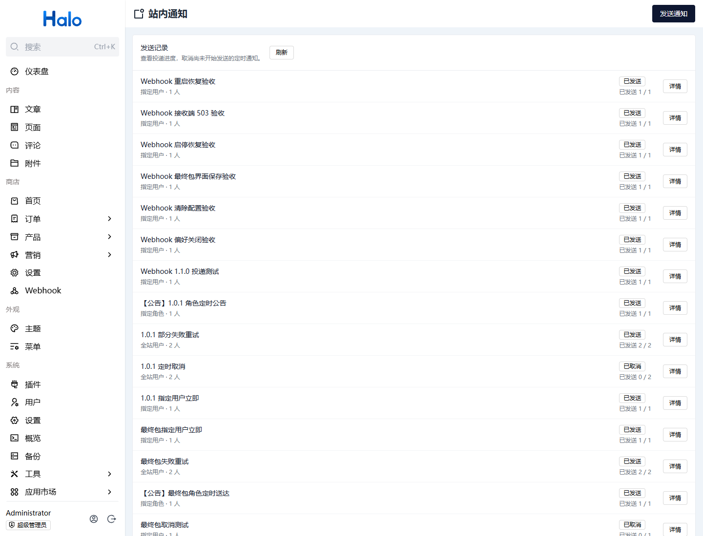
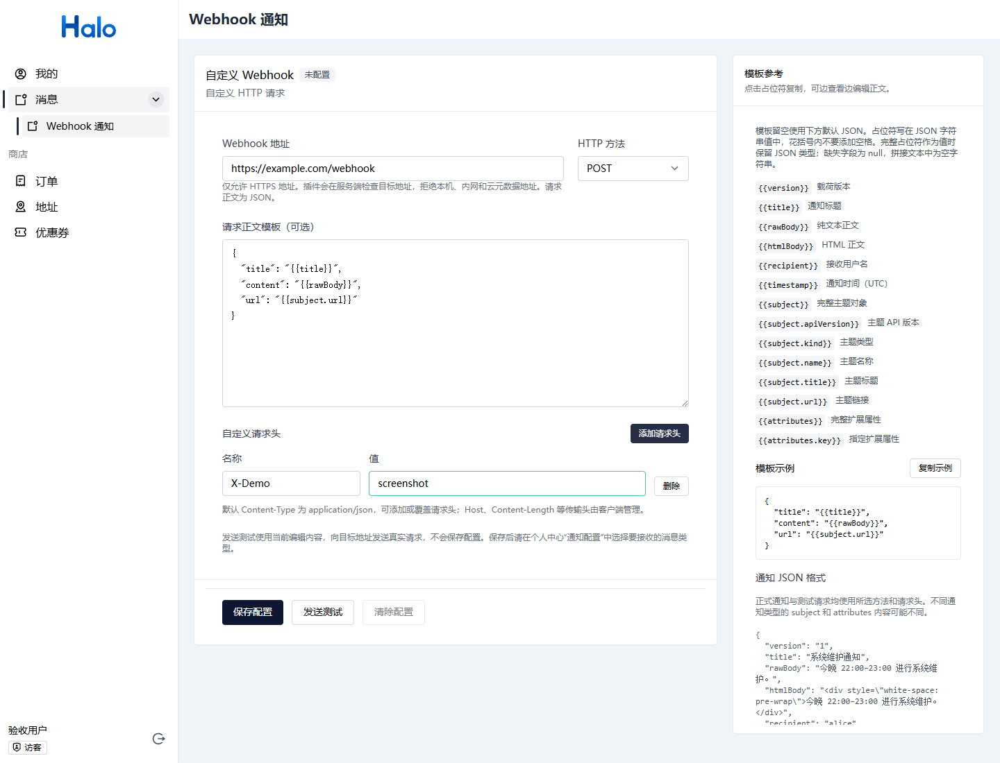
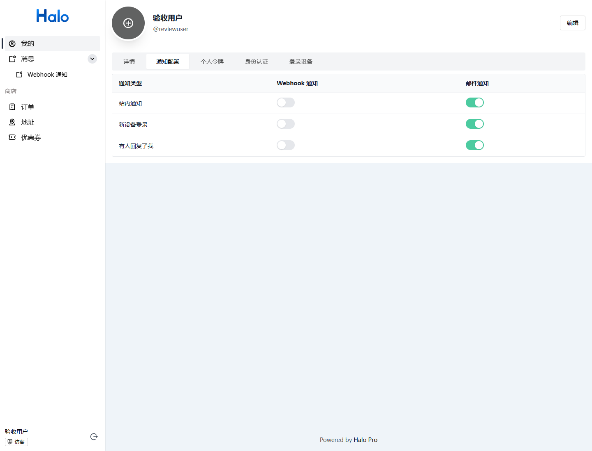

# 站内通知插件

<p align="center">
  
</p>

<p align="center">
  为 Halo 提供站内公告与消息管理，支持定向与定时发送，以及用户自定义 Webhook 通知
</p>

<p align="center">
  <a href="https://www.halo.run"></a>
  <a href="https://github.com/ilay1678/halo-plugin-site-notifications"></a>
  <a href="./LICENSE"></a>
</p>

## 简介

站内通知插件让超级管理员直接在 Halo 控制台发送公告和普通消息，可用于维护公告、活动通知或指定用户的业务提醒。接收用户在原生个人中心的“消息”中阅读，沿用 Halo 的未读、已读和删除功能。

## 功能特性

| 功能 | 说明 |
| --- | --- |
| 公告与普通消息 | 支持纯文本标题和正文，保留换行；用户中心的通知正文直接显示填写的正文，公告标题显示“【公告】”标识 |
| 全站发送 | 发送给提交时存在的有效注册用户，包含管理员 |
| 指定用户 | 搜索并多选接收用户 |
| 指定角色 | 搜索并多选角色，角色成员交集自动去重 |
| 接收人数预览 | 提交前预览人数，提交时确定最终名单 |
| 立即与定时发送 | 默认立即发送，可按浏览器本地时区指定未来时间 |
| 取消定时任务 | 尚未开始投递时可取消，保留取消人和取消时间 |
| 发送记录 | 查看正文、接收人、计划时间、进度和失败原因 |
| 失败重试 | 仅重试未成功接收者，保留已投递通知及其已读状态 |
| 启停恢复 | 任务持久化，启用或重启后恢复处理未取消的到期任务 |
| 邮件提醒 | 通过 Halo 通知中心发送；沿用用户的通知偏好、邮件通知器和 SMTP 配置 |
| 用户 Webhook | 用户中心配置个人 HTTPS Webhook，按 Halo 原生通知偏好接收本插件及系统其他通知类型 |

## 截图预览

### 消息发送



### 定时发送



### 消息列表



### Webhook 设置



### 订阅设置



## 系统要求

| 要求 | 说明 |
| --- | --- |
| Halo | 2.26.0 及以上；已在 2.26.1 实例验证 |
| 管理权限 | 超级管理员；普通用户通过原生个人中心接收自己的消息 |
| 浏览器 | 支持 Halo 控制台的现代浏览器 |


## 使用指南

### 发送公告或消息

1. 进入“系统 → 站内通知”，点击“发送通知”。
2. 选择“公告”或“普通消息”，填写标题与正文。
3. 选择接收范围；指定用户或角色时，可搜索并多选。
4. 等待接收人数预览，核对范围后提交。默认选择“立即发送”。
5. 在记录列表查看进度，打开“详情”查看接收名单、时间和失败原因。

标题最多 200 字符，正文最多 20000 字符。正文为纯文本，HTML 标签按文字显示；用户中心和邮件正文都直接使用此内容并保留换行。邮件底部的退订和“查看通知”链接由 Halo 标准邮件通知器统一追加。提交发送后由后台处理，关闭页面不会中断任务。

### 邮件提醒

插件通过 Halo 的标准通知中心发送邮件，不单独实现 SMTP。站内通知发送成功后，Halo 会按照该用户对“站内通知”类型的通知偏好，同时调用已启用的邮件通知器。要收到邮件，需要同时满足：

1. Halo 已启用邮件通知器，并且 SMTP 主机、端口、账号、密码和发件人配置正确。
2. 用户资料中有邮箱且邮箱已验证；未验证邮箱不会被 Halo 的邮件收件人解析器使用。
3. 用户的通知偏好没有关闭“站内通知”的邮件通道；未单独配置时，Halo 默认使用邮件通知器。关闭邮件通知时仍会收到用户中心站内消息。
4. SMTP 服务接受邮件，且目标邮箱没有退信、垃圾邮件拦截或发送频率限制。

如果登录提醒能收到邮件而插件消息没有邮件，先检查用户通知偏好中是否为“站内通知”类型启用了邮件通知，再查看 Halo 日志中的邮件通知器错误。登录提醒与插件通知使用同一套邮件通知器和 SMTP 配置；插件升级后新通知类型默认使用 Halo 的默认邮件通知器，但用户仍可单独关闭该类型的邮件通知。

### 用户 Webhook 通知

1. 登录用户中心，进入“消息”下的“Webhook 通知”，填写 Webhook 地址、HTTP 方法、请求头和可选 JSON 正文模板。完整地址会回显，可直接编辑。
2. 进入“我的 → 通知配置”，为需要接收的消息类型开启“Webhook 通知”通道，操作方式与邮件订阅相同。
3. 对应类型的通知到达后，插件按保存的配置发送请求。支持 POST（默认）、PUT、PATCH、GET、DELETE；GET 和 DELETE 不发送正文，已填写的模板会保留。
4. 点击“发送测试”，使用当前未保存的表单内容发送真实请求，并查看接收端的 HTTP 状态。测试不会保存配置；确认后点击“保存配置”。点击“清除配置”停止转发。

默认请求头为 `Content-Type: application/json`，可添加或覆盖请求头，最多 32 个、总大小不超过 16 KiB。`Host`、`Content-Length` 等传输头由客户端管理，不能自行设置。宽屏下，模板参考与编辑区左右并排，可点击占位符或“复制示例”边查阅边编辑；说明独立滚动，不影响保存、测试按钮。窄屏参考放在表单和按钮下方，提供无空格占位符、模板示例与默认 JSON。

通知器接入 Halo 的 `reactive-notifier` 扩展点，覆盖经过 Halo 通知中心投递给该用户的通知，包括本插件的站内消息、评论通知、登录提醒及其他插件注册的通知类型。只有用户开启的类型会转发；直接写入通知资源、未经过通知中心的消息不会触发通知器。管理员需要在 Halo 的通知扩展点中保持此通知器启用。

请求正文示例：

```json
{
  "version": "1",
  "title": "维护通知",
  "rawBody": "今晚将进行系统维护。",
  "htmlBody": "<p>今晚将进行系统维护。</p>",
  "recipient": "alice",
  "timestamp": "2026-10-14T00:00:00Z",
  "subject": {
    "apiVersion": "v1alpha1",
    "kind": "SiteMessageRecipient",
    "name": "message-001-alice",
    "title": "维护通知",
    "url": "/uc/notifications"
  },
  "attributes": {}
}
```

`subject` 与 `attributes` 由通知来源提供，不同通知类型可能不同。接收端应返回 2xx；此功能投递失败只记录错误类型，不阻断其他通知通道，也不自动重试。

地址仅允许 HTTPS、443 标准端口，禁止用户名/密码及 fragment，最多 4096 字符；拒绝本机、私网、链路本地、组播、云元数据等地址，并检查实际连接的全部 DNS 结果。请求不跟随重定向，连接超时 5 秒、整体超时 10 秒，响应正文最多 64 KiB。地址、方法、模板与请求头统一保存在每用户独立的 ConfigMap 中，不创建新的 Secret；配置按用户创建时间隔离，不使用用户名作为资源身份。删除用户时由用户清理控制器删除对应配置，避免同名用户复用旧配置。

### 指定发送时间

选择“指定时间”并填写未来的日期与时间。页面标明浏览器当前时区，后台按 UTC 存储和判断到期时间，展示时转换为浏览器本地时间。

到期后任务进入投递队列，实际完成时间受接收人数和 Halo 运行情况影响。停用插件或 Halo 停机期间不会发送；恢复运行后，未取消且已经到期的任务会补发。

### 取消定时发送

在仍处于“等待发送”的定时任务上点击“取消发送”，确认后任务变为“已取消”，保留记录、操作人和时间。计划时间已到但仍未开始投递的任务也可取消，以服务端实际状态为准。

取消与开始投递通过资源版本竞争，取消成功后不会发送。已经开始投递的任务无法取消；已取消任务不能恢复或重试，再次发送需要创建新任务。此功能不撤回已经送达的消息。

### 查看结果与重试

失败或部分失败的任务可从详情确认原因后重试。重试只处理原名单中未成功接收者，不修改已有通知及其已读状态。用户删除已经成功接收的通知后，普通重试不会再次生成该通知。

提交出现网络错误时，在同一弹窗保持内容不变重试会复用请求标识，避免重复创建任务。关闭弹窗后再次创建视为新的发送任务。

## 接收范围与保留规则

- 接收名单在提交时固定并去重；后续新增用户或角色成员不会追加。
- 全站范围排除禁用、隐藏和已删除账户；指定对象无效或名单为空时拒绝提交。
- 角色范围只解析直接绑定的成员，不把权限继承视为成员关系；不选择匿名、认证身份、隐藏角色或角色模板。
- 实际投递时发现账户已禁用、隐藏或删除，会记录失败原因，不改投给其他用户。
- 普通用户无权管理任务或查看接收人快照，仅能访问自己的原生消息。
- 通知阅读、删除和自动清理沿用 Halo 设置；发送记录独立保存，插件没有自动清理任务记录的功能。

## 开发指南

### 环境准备

| 工具 | 版本 |
| --- | --- |
| JDK | 21，必须包含 `javac`，JRE 不能用于编译 |
| Node.js | >=22.12.0 |
| pnpm | 10.33.0，由 Gradle 工程工具链准备 |

### 构建插件

Windows 使用工程提供的入口，按本机情况指定完整 JDK 路径：

```powershell
./build-local.ps1 -JdkPath "D:/your-jdk-21" -GradleArguments @("build", "--console=plain")
```

`build-local.ps1` 的默认 JDK 路径为 `D:/jdk/jdk-21.0.12.15`；路径不同时使用 `-JdkPath` 覆盖。脚本仅为本次构建指定 JDK，不修改全局环境变量。共享的 `gradle.properties` 不设置本机 JDK 路径。

macOS / Linux 安装 JDK 21，并确保 `JAVA_HOME` 指向该 JDK 后执行：

```bash
./gradlew build
```

GitHub Actions 通过工作流的 `java-version: 21` 安装 JDK，Gradle 使用 Runner 提供的 JDK，无需配置本地路径。

当前版本为 **1.3.0**，产物为 `build/libs/halo-plugin-site-notifications-1.3.0.jar`，包含后端、插件清单及 ESM 控制台和用户中心资源。前端类型检查、lint、格式与测试纳入 Gradle `check`。

业务 Java 包为 `top.ilay.sitenotifications`，根 Gradle group 为 `top.ilay`。送审时请使用完成安装与功能验收的同一个 JAR，并将实际文件大小、SHA-256 和运行结果更新到 [验证记录](docs/verification.md)；重新构建或改用 CI 制品后需要重新核对。

### 生成 API 客户端

TypeScript 客户端位于 `ui/src/api/generated`，使用 DevTools 从已启用插件的真实 OpenAPI 生成，复用 Halo 的 `axiosInstance`。

当前开发实例配置为 `http://localhost:8091`。开发实例需要开启 OpenAPI 并配置 `siteNotifications` 分组，包含管理 API 路径 `/apis/console.api.site-notifications.halo.run/v1alpha1/**` 和用户 API 路径 `/apis/api.site-notifications.halo.run/v1alpha1/**`，使 `/v3/api-docs/siteNotifications` 可访问，再运行：

```yaml
springdoc:
  api-docs:
    enabled: true
    version: OPENAPI_3_0
  group-configs:
    - group: siteNotifications
      paths-to-match:
        - /apis/console.api.site-notifications.halo.run/v1alpha1/**
        - /apis/api.site-notifications.halo.run/v1alpha1/**
```

Windows 下使用 OpenAPI 3.0，避免当前生成器处理 OpenAPI 3.1 文件时出现 Windows 路径 URI 错误。配置仅用于本地开发实例。

```powershell
./build-local.ps1 -GradleArguments @("generateApiClient", "-x", "build")
```

复用其他端口的现有实例时，通过 Gradle 属性指定地址，例如本次隔离验收容器：

```powershell
./build-local.ps1 -GradleArguments @("generateApiClient", "-x", "build", "-PhaloExternalUrl=http://localhost:8093")
```

首次没有生成客户端时，可先构建后端启动包：

```powershell
./build-local.ps1 -GradleArguments @("jar", "-x", "processUiResources")
```

安装并启用后生成客户端，再完整构建。修改 manifest 会触发 UI 重建，确保插件标识与打包资源一致。

### 工程结构

```text
halo-plugin-site-notifications/
├── src/main/java/top/ilay/sitenotifications/  # 校验、名单解析、管理 API 和后台投递
├── src/main/resources/                      # plugin.yaml 与 Logo
├── src/test/                                # 后端行为测试
├── ui/src/
│   ├── api/                                 # 客户端实例和生成契约
│   ├── components/                          # 发送弹窗与任务详情
│   ├── utils/                               # 时间、请求身份和候选回填
│   └── views/                               # 控制台发送记录
├── docs/                                    # 截图和验证记录
├── build-local.ps1                          # Windows JDK 构建入口
└── build.gradle                             # Halo 依赖及打包配置
```

后端按请求校验、接收人解析、任务服务、鉴权和投递拆分职责；Webhook 按地址校验、ConfigMap 存储、用户 API 和通知器拆分，复用 Halo 原生通知偏好。控制台及用户中心复用 Halo FormKit 与宿主组件，收件箱沿用原生消息。构建检查和独立实例验证范围见 [验证记录](docs/verification.md)。

## 管理 API

所有接口仅超级管理员可用，基础路径为 `/apis/console.api.site-notifications.halo.run/v1alpha1`。

| 方法 | 路径 | 用途 |
| --- | --- | --- |
| GET / POST | `/messages` | 分页记录 / 创建发送 |
| GET | `/messages/{name}` | 发送详情 |
| POST | `/messages/{name}/cancel` | 取消定时任务 |
| POST | `/messages/{name}/retry` | 重试失败接收者 |
| POST | `/recipients/preview` | 接收人数预览 |
| GET | `/recipients/users?keyword=` | 搜索用户摘要 |
| GET | `/recipients/roles?keyword=` | 搜索角色摘要 |

创建请求示例：

```json
{
  "requestId": "maintenance-20261010-001",
  "title": "维护通知",
  "content": "今晚将进行系统维护，请提前保存正在编辑的内容。",
  "type": "ANNOUNCEMENT",
  "target": "USERS",
  "usernames": ["alice", "bob"],
  "sendMode": "SCHEDULED",
  "scheduledAt": "2026-10-10T20:00:00+08:00"
}
```

`target` 为 `ALL`、`USERS` 或 `ROLES`，仅为对应范围提供 `usernames` 或 `roles`。`sendMode` 省略时为 `IMMEDIATE`，此时不要提供 `scheduledAt`；`SCHEDULED` 必须提供未来且带时区偏移的 ISO 日期时间。示例时间需替换为实际未来时间。

无效输入返回 400，无权限返回 403，任务不存在返回 404；已开始任务取消、已取消任务重试、同一 `requestId` 对应不同内容返回 409。

### 用户 Webhook API

基础路径为 `/apis/api.site-notifications.halo.run/v1alpha1/userspaces/{username}/webhook`。GET 返回配置状态、完整地址、方法、模板及请求头，PUT 保存以下配置，DELETE 清除。登录用户只能访问与本人用户名一致的路径，无效配置返回 400，越权访问返回 403。

```json
{
  "url": "https://example.com/hook",
  "method": "POST",
  "template": "{\"title\":\"{{title}}\"}",
  "headers": {"X-Source": "Halo"}
}
```

向基础路径下的 `/-/test` 发送 POST，正文同上，以当前配置发起真实测试，不写入存储。响应包含 `success`、接收端 `statusCode` 与 `message`；接收端非 2xx 或连接失败时 `success` 为 false，连接失败时没有状态码。

插件启动时会把旧版本共享 Secret 中可匹配当前用户的地址和模板迁移到独立 ConfigMap，迁移未完成时保留旧数据等待下次启动。旧配置缺少方法与请求头时，默认使用 POST 和空自定义请求头。

## 常见问题

### 用户在哪里接收消息？

登录 Halo 后进入原生个人中心的“消息”。插件使用 Halo 原生通知中心创建消息，因此用户中心通知正文直接显示填写的正文；邮件提醒由 Halo 邮件通知器按用户偏好发送。用户也可配置个人 Webhook，转发已订阅的通知类型。

### 为什么只看到站内消息，没有收到邮件？

站内消息和邮件是 Halo 通知中心的两个独立通道。站内消息可以正常创建，并不代表 SMTP 邮件一定发送成功。依次检查邮件通知器是否启用、SMTP 配置、收件用户邮箱是否已验证，以及该用户对“站内通知”类型是否启用了邮件；最后查看 Halo 日志确认 SMTP 是否被拒信。

### 为什么看不到“站内通知”菜单？

确认 Halo 版本为 2.26.0 及以上、插件已启用，并使用超级管理员登录。安装或升级后刷新控制台。

### 定时任务为什么没有在计划时刻完成？

计划时间是允许开始投递的时间。实例停机、插件停用或任务排队都会延后处理；查看任务详情中的实际开始时间、进度及失败原因。

### 能否撤回已发送消息或编辑取消后的任务？

当前不支持撤回、任务内容编辑、用户互发私信、富文本或附件。已取消任务保留审计记录，需要再次发送时创建新任务。

## 反馈与贡献

通过 [Issues](https://github.com/ilay1678/halo-plugin-site-notifications/issues) 提交问题或建议，也可提交 Pull Request。反馈问题时提供 Halo 版本、插件版本、复现步骤与相关错误信息，请勿附带密码、令牌或用户消息正文。

## 许可证

本项目采用 [GPL-3.0](./LICENSE) 许可证，作者为 [ilay](https://github.com/ilay1678)。

## 相关链接

- [源码仓库](https://github.com/ilay1678/halo-plugin-site-notifications)
- [Halo 官网](https://www.halo.run)
- [Halo 插件开发文档](https://docs.halo.run/developer-guide/plugin/index)
- [插件 manifest 说明](https://docs.halo.run/developer-guide/plugin/basics/manifest)
